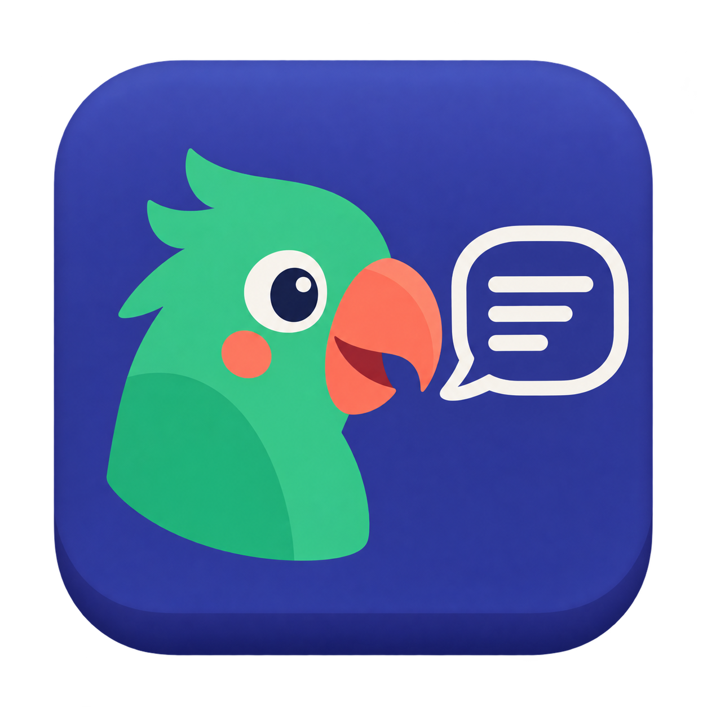
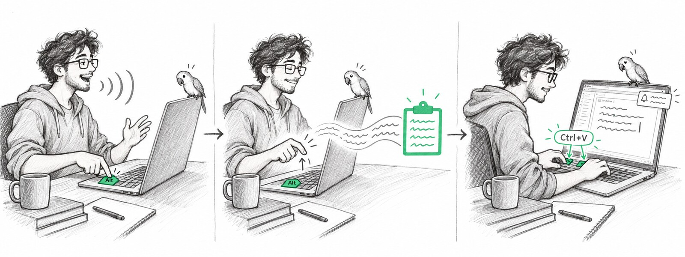

#  Altalk



*Зажми Left Alt и говори → отпусти → вставляй текст через `Ctrl+V`.*

**Alt + talk**: голос → текст через OpenAI API (`gpt-4o-mini-transcribe`, ~$0.003/мин).
Linux и Windows 10/11.

- **Push-to-talk**: держишь Left Alt — пишет микрофон, отпустил — текст в буфер обмена
  + уведомление. Нажатие любой другой клавиши, клик или прокрутка мышью при зажатом Alt
  отменяют запись.
- **Трей**: в меню иконки — 5 последних транскрипций (время + начало текста). Клик по
  любой копирует её текст в буфер обмена, иконка в трее на секунду становится галочкой.
  «Выйти» закрывает приложение.
- **Настройки…** в меню трея: ключ OpenAI, модель распознавания (`gpt-4o-mini-transcribe` —
  по умолчанию, `gpt-4o-transcribe`, `gpt-transcribe`, `whisper-1`), клавиша записи (Left Alt —
  по умолчанию, или Left Ctrl) и автозапуск при входе в систему. Ключ проверяется при
  сохранении, всё применяется сразу, без перезапуска. Окно — стандартное для системы:
  GTK 4 + libadwaita в Linux, обычные элементы Windows в Windows.
- **Свои термины**: `vocabulary.json` рядом с настройками (образец — `vocabulary.example.json`):
  `prompt` — подсказка для распознавания, `corrections` — regex-правки после него.

## Установка

Готовые файлы — на странице [Releases](https://github.com/Santttal/altalk/releases/latest).
Внутри каждого пакета один исполняемый файл с Python и всеми библиотеками. В Linux из системы
берутся только звук (ALSA) и, для окна настроек, GTK 4 + libadwaita — менеджер пакетов
поставит их сам. В Windows не нужно ничего.

| Система | Установка |
|---|---|
| Windows 10, 11 (x64) | `altalk-0.2.0-setup-x64.exe` — установщик, права администратора не нужны |
| Windows без установки | `altalk-windows-x64.exe` — просто запустить |
| Ubuntu 22.04+, Debian 12+, Linux Mint 21+ | `sudo apt install ./altalk_0.2.0_amd64.deb` |
| Fedora, RHEL / AlmaLinux / Rocky 9 | `sudo dnf install ./altalk-0.2.0-1.x86_64.rpm` |
| Arch, Manjaro | `sudo pacman -U altalk-0.2.0-1-x86_64.pkg.tar.zst` |
| Любой Linux x86-64 с glibc 2.30+ | `install -m755 altalk-linux-x86_64 ~/.local/bin/altalk && altalk --install` |

При первом запуске откроются настройки — вставь ключ OpenAI. Он хранится в
`~/.config/altalk/.env` (Linux) или `%APPDATA%\Altalk\.env` (Windows).

**Linux.** Один раз дай доступ к клавиатуре:

```bash
sudo usermod -aG input $USER   # Alt читается из /dev/input; после этого перелогиниться
```

Значок в трее: в Ubuntu и KDE работает сразу. В GNOME на Fedora, Debian и Arch нужно
расширение AppIndicator (`gnome-shell-extension-appindicator`) — поставить и включить
в приложении «Расширения».

**Windows.** Файлы не подписаны, поэтому при первом запуске SmartScreen покажет «Система Windows
защитила ваш компьютер» — «Подробнее» → «Выполнить в любом случае». Новые значки Windows прячет
под стрелку «^» на панели задач — значок Altalk можно перетащить оттуда на панель. Микрофон
открывается только пока клавиша зажата, так что индикатор «микрофон используется» не висит
постоянно.

## Запуск

Из меню приложений (или «Пуск») — **Altalk**, или `altalk` в терминале Linux. Закрыть — «Выйти»
в меню трея. Второй экземпляр не запустится: в Linux покажет уведомление «Уже запущен», в Windows
откроет настройки уже запущенного.
Лог: `~/.local/state/altalk/altalk.log` (Linux), `%LOCALAPPDATA%\Altalk\altalk.log` (Windows).

## Сборка

```bash
./packaging/build.sh   # → dist/: .deb, .rpm, .pkg.tar.zst, altalk-linux-x86_64,
                       #   altalk-*-setup-x64.exe, altalk-windows-x64.exe, SHA256SUMS
```

Нужен только Docker. Linux собирается в контейнере Debian 11 (`packaging/Dockerfile`), поэтому
бинарник требует лишь glibc 2.30+ и работает на всех системах из таблицы выше. Windows —
в контейнере с Wine (`packaging/Dockerfile.windows`): Python для Windows, PyInstaller
и Inno Setup для установщика.

Из исходников без сборки: `python3 -m pip install -r requirements.txt`, ключ в `.env` рядом
со скриптом (`cp .env.example .env`), затем `python3 icon2.py`.

## Лицензия

MIT — см. [LICENSE](LICENSE).
